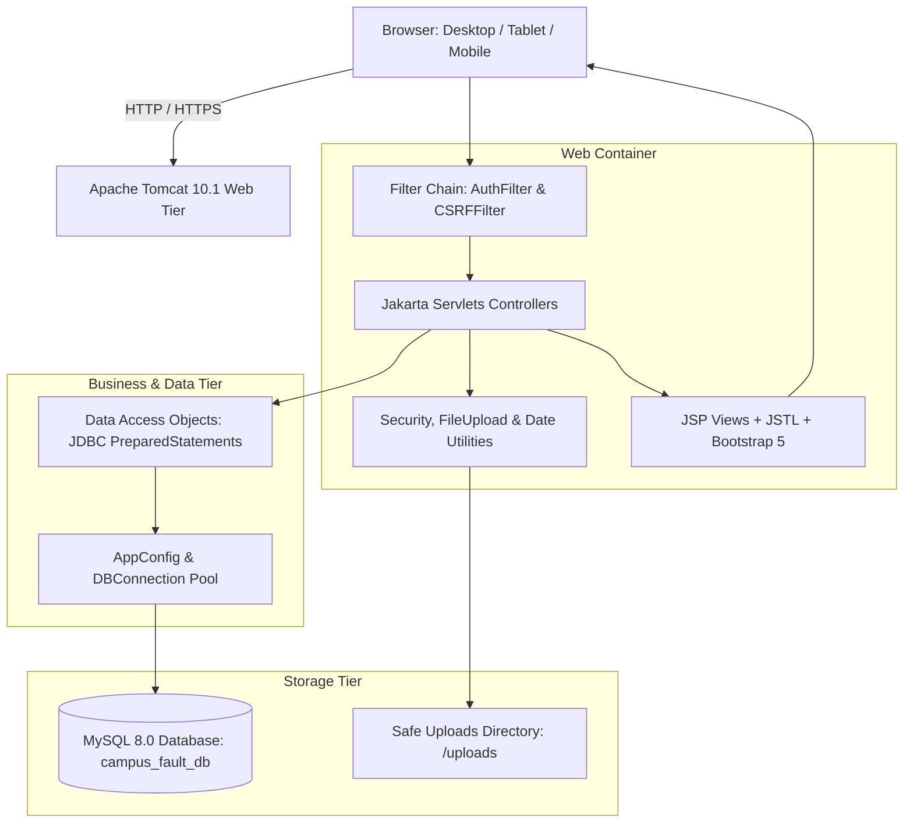
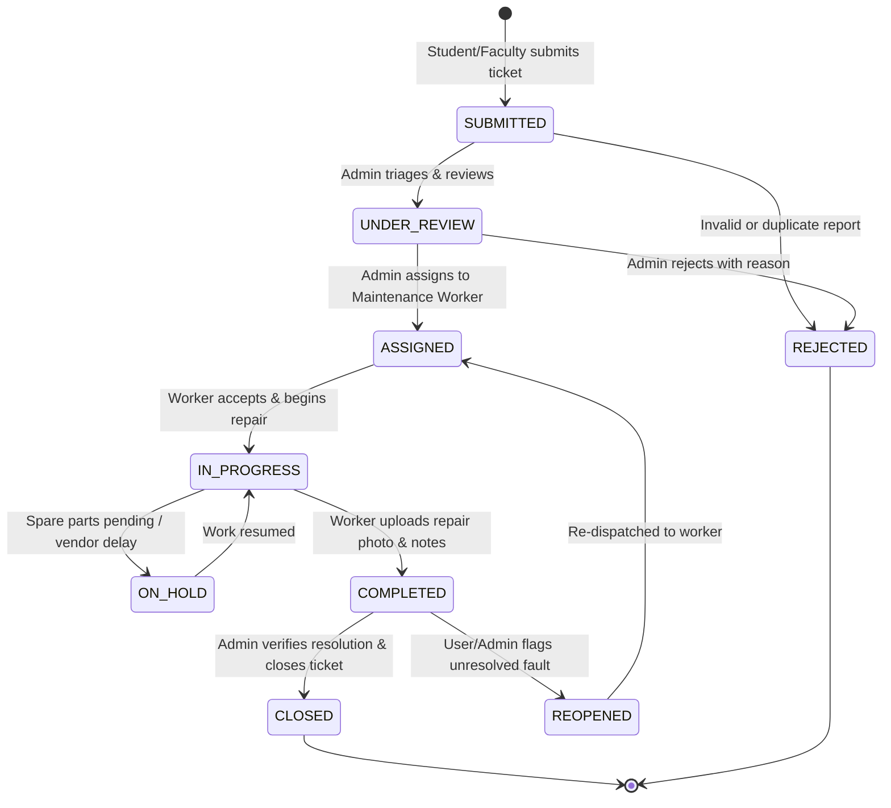

# Campus Infrastructure Fault Reporting System

> A centralized, production-grade digital platform designed for college campuses to streamline fault reporting, maintenance dispatch, ticket tracking, and infrastructure analytics.

---

## 1. Project Overview

Manual registers, informal messaging channels, and delayed physical complaints often lead to unaddressed infrastructure failures across college campuses—ranging from broken laboratory equipment and plumbing leaks to electrical hazards and network outages. 

The **Campus Infrastructure Fault Reporting System** bridges the communication divide between campus occupants (students and faculty), facilities management administrators, and maintenance field technicians.

### Key Highlights
- **Role-Based Access Control (RBAC):** Distinct dashboards and security boundaries for **Student/Faculty**, **Administrator**, and **Maintenance Workers**.
- **Real-Time Lifecycle Tracking:** Strict status progression: `SUBMITTED` &rarr; `UNDER_REVIEW` &rarr; `ASSIGNED` &rarr; `IN_PROGRESS` &rarr; `COMPLETED` &rarr; `CLOSED` (with support for `REJECTED`, `ON_HOLD`, and `REOPENED`).
- **Before-and-After Photographic Proof:** Secure multi-part file uploads allowing students to upload initial defect photos and maintenance technicians to submit resolution evidence photos.
- **Auditable Status Timeline:** Complete status audit log capturing timestamp, acting user, status change, and internal or public remarks.
- **Executive Analytics & Reporting:** Interactive Chart.js visual dashboards displaying category breakdowns, status distributions, overdue tickets, and one-click CSV report exports.
- **Enterprise-Grade Security:** BCrypt password hashing, session-based authentication, CSRF token validation on mutating actions, PreparedStatements SQL injection protection, context-aware HTML sanitization, and strictly validated file uploads.

---

## 2. Technology Stack

| Layer | Technologies / Frameworks |
| :--- | :--- |
| **Frontend** | HTML5, CSS3, JavaScript (ES6+), Bootstrap 5.3.3, Bootstrap Icons 1.11.3, Chart.js 4.4.1 |
| **Backend Framework** | **Spring Boot 3.2.4**, Spring MVC, Spring DI / IoC, Spring Transaction Management (`@Transactional`) |
| **Service & Business Layer** | Dedicated Spring `@Service` layer (`ComplaintService`, `UserService`, `NotificationService`, `StorageService`) |
| **Persistence Layer** | Spring `@Repository` DAOs with **Spring `JdbcTemplate`**, `RowMapper`, and HikariCP connection pooling |
| **Database** | MySQL 8.0+ (`campus_fault_db`) with InnoDB engine, Foreign Keys, Cascades & Indexes |
| **Security** | jBCrypt 0.4, Spring MVC `HandlerInterceptor` (`AuthInterceptor`), CSRF token protection |
| **View Engine** | Jakarta Server Pages (JSP) 3.1 & JSTL 3.0 rendered via Spring `InternalResourceViewResolver` |
| **Build & Tooling** | Apache Maven 3.9+, Embedded Apache Tomcat 10.1 (Spring Boot Web Starter) |
| **Testing** | JUnit 5 Jupiter, Spring Boot Test (`@SpringBootTest`), Java `HttpClient` E2E Suite |

---

## 3. System Architecture & Workflows

### 3.1 High-Level Architecture



### 3.2 Complaint Lifecycle Workflow



---

## 4. Directory & Package Structure

```
d:/New folder/
├── database/
│   ├── schema.sql                 # Complete DDL: 9 normalized tables, indexes, constraints
│   └── sample_data.sql            # Realistic seed: 9 users, 7 buildings, 9 categories, 6 tickets
├── pom.xml                        # Maven dependencies, plugins, and embedded Tomcat configuration
├── src/
│   ├── main/
│   │   ├── java/com/campus/
│   │   │   ├── EmbeddedServer.java        # Zero-install Tomcat 10.1 runner (Port 8080)
│   │   │   ├── config/
│   │   │   │   ├── AppConfig.java         # Centralized properties loader (db.properties)
│   │   │   │   └── DBConnection.java      # Resilient JDBC connection manager
│   │   │   ├── controller/
│   │   │   │   ├── AdminComplaintServlet.java # Ticket triage, assignment, worker dispatch
│   │   │   │   ├── AuthServlet.java       # Login, register, logout with BCrypt
│   │   │   │   ├── BuildingServlet.java   # Admin building & location CRUD
│   │   │   │   ├── CategoryServlet.java   # Admin fault category CRUD
│   │   │   │   ├── ComplaintServlet.java  # Student ticket submission & detail view
│   │   │   │   ├── DashboardServlet.java  # Role-routed executive metric dashboards
│   │   │   │   ├── FileServlet.java       # Secure file streaming & MIME delivery
│   │   │   │   ├── NotificationServlet.java # In-app notification center & mark-as-read
│   │   │   │   ├── ReportServlet.java     # CSV exports & Chart.js data endpoints
│   │   │   │   └── WorkerComplaintServlet.java# Worker task queue, progress, proof upload
│   │   │   ├── dao/
│   │   │   │   ├── AssignmentDAO.java     # Worker assignment queries
│   │   │   │   ├── AttachmentDAO.java     # File metadata persistence
│   │   │   │   ├── BuildingDAO.java       # Building data queries
│   │   │   │   ├── CategoryDAO.java       # Fault category queries
│   │   │   │   ├── CommentDAO.java        # Audit commentary persistence
│   │   │   │   ├── ComplaintDAO.java      # Complaint queries, metrics & filters
│   │   │   │   ├── NotificationDAO.java   # User in-app notification queries
│   │   │   │   ├── StatusHistoryDAO.java  # Audit timeline log queries
│   │   │   │   └── UserDAO.java           # Authentication and worker registry
│   │   │   ├── filter/
│   │   │   │   ├── AuthFilter.java        # Session verification & RBAC boundary enforcer
│   │   │   │   └── CSRFFilter.java        # Anti-CSRF token verification filter
│   │   │   ├── model/
│   │   │   │   ├── Building.java
│   │   │   │   ├── Complaint.java
│   │   │   │   ├── ComplaintAssignment.java
│   │   │   │   ├── ComplaintAttachment.java
│   │   │   │   ├── ComplaintComment.java
│   │   │   │   ├── FaultCategory.java
│   │   │   │   ├── Notification.java
│   │   │   │   ├── StatusHistory.java
│   │   │   │   └── User.java
│   │   │   └── util/
│   │   │       ├── CSRFUtil.java          # Cryptographic session CSRF token generator
│   │   │       ├── DateUtil.java          # Human-friendly timestamps & formatters
│   │   │       ├── FileUploadUtil.java    # Strict file type validation (<10MB, UUID names)
│   │   │       ├── PasswordUtil.java      # Secure jBCrypt hashing & verification
│   │   │       └── SecurityUtil.java      # XSS prevention & HTML escape sanitization
│   │   ├── resources/
│   │   │   └── db.properties              # Database credentials & pool limits
│   │   └── webapp/
│   │       ├── index.jsp                  # Root entryway redirecting to /dashboard
│   │       ├── static/
│   │       │   ├── css/style.css          # Modern Deep Navy theme & responsive styles
│   │       │   └── js/
│   │       │       ├── chart-config.js    # Chart.js initialization & data rendering
│   │       │       └── main.js            # Client-side validation, previews, modals
│   │       └── WEB-INF/
│   │           ├── web.xml                # Servlet 6.0 deployment descriptor
│   │           └── views/
│   │               ├── admin/             # Dashboard, complaints list, dispatch, reports, etc.
│   │               ├── auth/              # Modern login & student registration pages
│   │               ├── common/            # Header, navbar, sidebar, footer, notifications
│   │               ├── error/             # Styled 403 Forbidden, 404 Not Found, 500 Server Error
│   │               ├── student/           # Student dashboard, submit form, ticket details
│   │               └── worker/            # Maintenance work queue, task details, proof upload
│   └── test/java/com/campus/
│       ├── ComplaintDAOTest.java          # Database query & complaint lifecycle tests
│       ├── IntegrationFlowTest.java       # E2E HTTP client tests (Login, RBAC, Dashboards)
│       ├── PasswordUtilTest.java          # jBCrypt validation tests
│       └── SecurityUtilTest.java          # XSS escaping & sanitization tests
└── README.md
```

---

## 5. Database Setup

The database schema is fully normalized and adheres strictly to MySQL 8.0+ standards.

### 5.1 Initialize Database & Tables

Execute the following commands in your MySQL client (`mysql -u root -p`):

```sql
CREATE DATABASE IF NOT EXISTS campus_fault_db CHARACTER SET utf8mb4 COLLATE utf8mb4_unicode_ci;
USE campus_fault_db;
```

Load the schema definition:
```bash
mysql -u root -p campus_fault_db < "database/schema.sql"
```

Load the sample data seed:
```bash
mysql -u root -p campus_fault_db < "database/sample_data.sql"
```

### 5.2 Database Configuration File

Database connection parameters are located in:
[`src/main/resources/db.properties`](file:///d:/New%20folder/src/main/resources/db.properties)

```properties
db.driver=com.mysql.cj.jdbc.Driver
db.url=jdbc:mysql://localhost:3306/campus_fault_db?useSSL=false&allowPublicKeyRetrieval=true&serverTimezone=UTC&characterEncoding=UTF-8
db.username=root
db.password=root
```

---

## 6. Pre-Seeded Demo Accounts

All pre-seeded passwords have been encrypted using BCrypt (`$2a$10$...`).

| Role | Username | Password | Full Name | Department / Specialty |
| :--- | :--- | :--- | :--- | :--- |
| **Administrator** | `admin` | `admin123` | Dr. Robert Vance | Estate & Facilities Management |
| **Student** | `student1` | `student123` | Alex Johnson | Computer Science (B.Tech 3rd Yr) |
| **Student** | `student2` | `student123` | Priya Sharma | Electronics (B.Tech 2nd Yr) |
| **Faculty** | `prof_smith` | `faculty123` | Prof. Arthur Smith | Dept. of Mechanical Engineering |
| **Faculty** | `dr_chen` | `faculty123` | Dr. Elena Chen | Dept. of Electrical Sciences |
| **Maintenance** | `worker_elec` | `worker123` | Marcus Miller | Senior Electrician |
| **Maintenance** | `worker_plumb` | `worker123` | James Wilson | Master Plumber |
| **Maintenance** | `worker_it` | `worker123` | Rajesh Kumar | Campus Network & IT Systems |
| **Maintenance** | `worker_civil` | `worker123` | Thomas Scott | Civil & Carpentry Works |

> **Tip:** The Login page includes **Quick Demo Login** pills that autofill the credentials for instant testing!

---

## 7. How to Run the Application

### Option A: Zero-Install Embedded Tomcat Runner (Recommended)

The project includes an embedded Apache Tomcat 10.1 runtime configured directly inside `pom.xml`. You do not need an external application server installed.

1. Open PowerShell or Terminal in the project root:
   ```powershell
   cd "d:\New folder"
   ```
2. Run the application via Maven:
   ```powershell
   mvn compile exec:java
   ```
3. Open your browser and navigate to:
   ```
   http://localhost:8080/campus-fault-system
   ```

---

### Option B: Deploy Standalone WAR to Apache Tomcat 10.1

1. Package the project WAR file:
   ```powershell
   mvn clean package
   ```
   *This compiles the source code and packages everything into:*  
   `target/campus-fault-system.war` (~15.2 MB, includes all required Jakarta JARs).
2. Copy `target/campus-fault-system.war` into your Tomcat installation's `webapps/` folder:
   ```powershell
   copy target\campus-fault-system.war "C:\apache-tomcat-10.1.x\webapps\"
   ```
3. Start Tomcat (`bin/startup.bat` or `bin/catalina.sh run`).
4. Access the application at:
   ```
   http://localhost:8080/campus-fault-system
   ```

---

## 8. Role-Based Features & Walkthrough

### 8.1 Student / Faculty Portal
- **Dashboard:** Shows live statistics (Total, Pending, In Progress, Resolved) and recent activity.
- **Fault Reporting:**
  - Auto-generated unique ticket number format: `CFT-YYYYMMDD-XXXX`.
  - Category selection (Electrical, Plumbing, Furniture, IT, Lab, etc.).
  - Campus Building, Block, Floor, and Specific Room/Area.
  - Priority Level (`LOW`, `MEDIUM`, `HIGH`, `URGENT`).
  - Defect photo upload with instant client-side preview and MIME type validation.
- **Ticket Tracking & Timeline:** Detailed audit log showing timestamps, current status, assigned technician, and public remarks.
- **Reopen Ticket:** If a problem persists after completion, students can submit a reopen request directly with notes.

### 8.2 Administrator Portal
- **Executive Operations Dashboard:**
  - Real-time KPI cards: Total Complaints, Unassigned, High-Priority, In-Progress, Average Resolution Time.
  - Interactive **Chart.js** visuals: Category Breakdown Doughnut chart and Monthly Resolution Bar chart.
- **Complaint Triage & Worker Dispatch:**
  - Search and filter complaints by Category, Building, Status, Priority, or Ticket ID.
  - One-click Assign Modal: Select available maintenance technician, set due date, and attach internal repair instructions.
  - Direct status overrides (`UNDER_REVIEW`, `REJECTED`, `CLOSED`).
- **Campus Infrastructure Management:**
  - Campus Buildings: Add/edit buildings, codes, and number of floors.
  - Fault Categories: Add/edit categories, icons, and descriptions.
  - User Management: View registered students, faculty, and maintenance staff.
- **Reporting & Export:**
  - Filter historical complaints by date range, category, building, and status.
  - Export filtered complaint reports to CSV format.

### 8.3 Maintenance Worker Portal
- **Work Order Queue:** View all tasks assigned to the logged-in technician, sorted by priority and due date.
- **Task Detail & Workflow Controls:**
  - Accept assignment and advance status to `IN_PROGRESS`.
  - Mark task `ON_HOLD` with delay explanation (e.g., awaiting spare parts).
  - Add ongoing repair progress notes.
- **Resolution Proof:**
  - Mark task `COMPLETED`.
  - Mandatory or optional **After-Repair Photograph Upload** as verifiable resolution proof.

---

## 9. Security Implementations

1. **Password Encryption:** All passwords are cryptographically salted and hashed using `jBCrypt` (Blowfish algorithm with work factor 10). Plain-text passwords are never stored.
2. **SQL Injection Defense:** All database interactions in every DAO use JDBC `PreparedStatement` with parameterized inputs. No dynamic string concatenation is used in SQL queries.
3. **Role-Based Authorization (`AuthFilter`):** Every request path (`/admin/*`, `/worker/*`, `/student/*`, `/complaints/*`) is intercepted. Sessions are validated, and attempts to access unauthorized roles immediately return a structured `403 Forbidden` response.
4. **Cross-Site Request Forgery (CSRF) Protection:** State-changing requests (`POST`) are protected with session-bound, cryptographically random CSRF tokens validated by `CSRFFilter`.
5. **Cross-Site Scripting (XSS) Mitigation:** Context-aware escaping is enforced on all user-supplied inputs using `SecurityUtil.escapeHtml()` and JSTL `<c:out>`.
6. **Secure Multi-Part File Uploads:** Uploaded defect and repair photographs are verified for:
   - Maximum file size (10 MB per file).
   - Allowed MIME types (`image/jpeg`, `image/png`, `image/webp`).
   - Secure UUID-based file renaming to prevent directory traversal or remote execution attacks.
   - Streaming delivery via `FileServlet` rather than direct script execution paths.

---

## 10. Automated Testing Suite

The project includes both unit tests and live HTTP integration tests using JUnit 5:

```powershell
mvn test
```

### Test Results Summary (14 Tests - 100% Passed)
- **`PasswordUtilTest` (2 tests):** Confirms BCrypt hashing randomness, validation, and rejection of invalid passwords.
- **`SecurityUtilTest` (3 tests):** Validates HTML escaping against `<script>`, attribute injections, and null-safety.
- **`ComplaintDAOTest` (4 tests):** Validates database queries, complaint creation, status transitions, and metric calculations.
- **`IntegrationFlowTest` (5 tests):**
  - `testLoginPageLoads`: Verifies HTTP 200 and login form fields.
  - `testAdminLoginAndDashboardAccess`: Verifies successful session creation and admin KPI rendering.
  - `testStudentLoginAndDashboardAccess`: Verifies student portal access and ticket history.
  - `testWorkerLoginAndDashboardAccess`: Verifies technician dispatch queue access.
  - `testRbacEnforcementStudentAccessingAdmin`: Confirms `AuthFilter` returns HTTP 403 when a student tries to access admin-only endpoints.

---

## 11. Troubleshooting & FAQ

### Issue: "Port 8080 already in use"
**Solution:** If another application (or an existing Tomcat instance) is using port 8080:
- Stop the conflicting process via Task Manager or PowerShell:
  ```powershell
  Get-Process -Id (Get-NetTCPConnection -LocalPort 8080).OwningProcess | Stop-Process -Force
  ```
- Or change the port in [`src/main/java/com/campus/EmbeddedServer.java`](file:///d:/New%20folder/src/main/java/com/campus/EmbeddedServer.java) from `8080` to `8081`.

### Issue: "Communications link failure / Access denied for user 'root'@'localhost'"
**Solution:** Ensure MySQL 8.0 service is running:
- Start MySQL service in Windows Services (`services.msc`) or via PowerShell:
  ```powershell
  Start-Service MySQL80
  ```
- Verify your password in [`src/main/resources/db.properties`](file:///d:/New%20folder/src/main/resources/db.properties).

### Issue: "ClassNotFoundException: jakarta.servlet.*"
**Solution:** Ensure you are using Apache Tomcat 10.1 or later (which supports the `jakarta.*` namespace for Servlet 6.0 and JSP 3.1). Older Tomcat 9 or below uses the legacy `javax.*` namespace and is not compatible.

---

## 12. Academic Project Verification Checklist

- [x] **Complete Functional Application:** Frontend, backend, database, authentication, and reporting fully implemented.
- [x] **No Mock Data:** All statistics, charts, complaints, and users are dynamically loaded from MySQL.
- [x] **All User Roles Supported:** Student, Faculty, Administrator, and Maintenance Worker.
- [x] **Complaint Lifecycle Implemented:** Submitted &rarr; Under Review &rarr; Assigned &rarr; In Progress &rarr; Completed &rarr; Closed (with Reopen, Reject, and On-Hold flows).
- [x] **Secure Photo Uploads:** Initial defect photos and repair completion photos with thumbnails and viewer modals.
- [x] **Responsive UI/UX:** Bootstrap 5, Deep Navy theme, mobile sidebar toggle, accessible contrast, and clean layout.
- [x] **Zero-Install Run Option:** Embedded Tomcat 10.1 runner ready via `mvn compile exec:java`.
